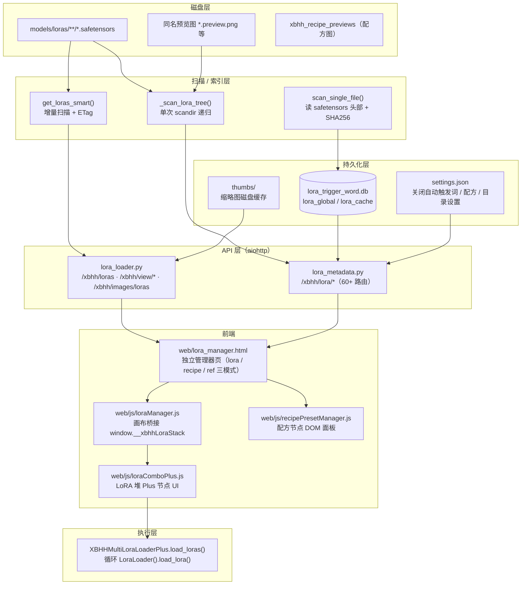
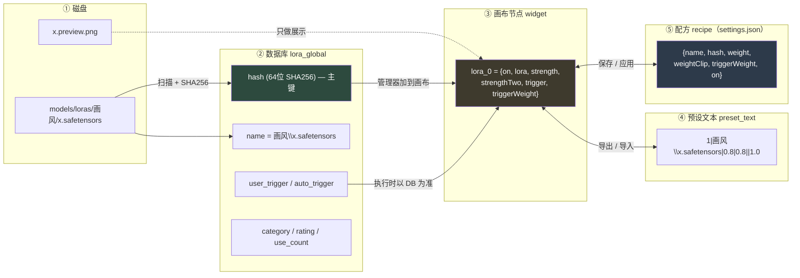
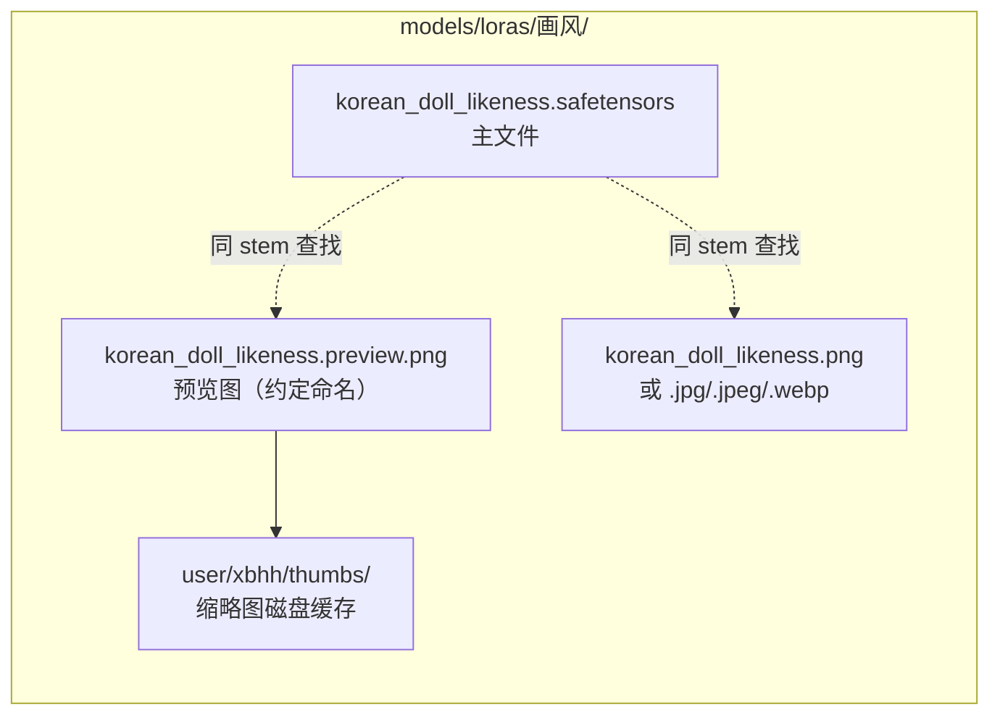
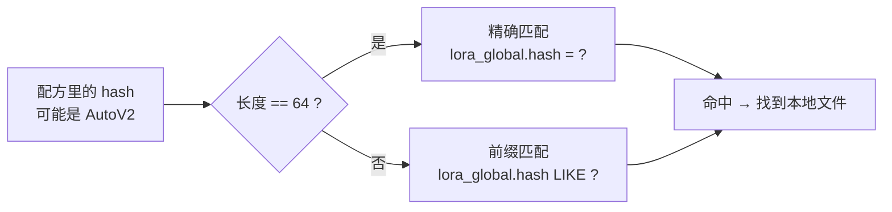
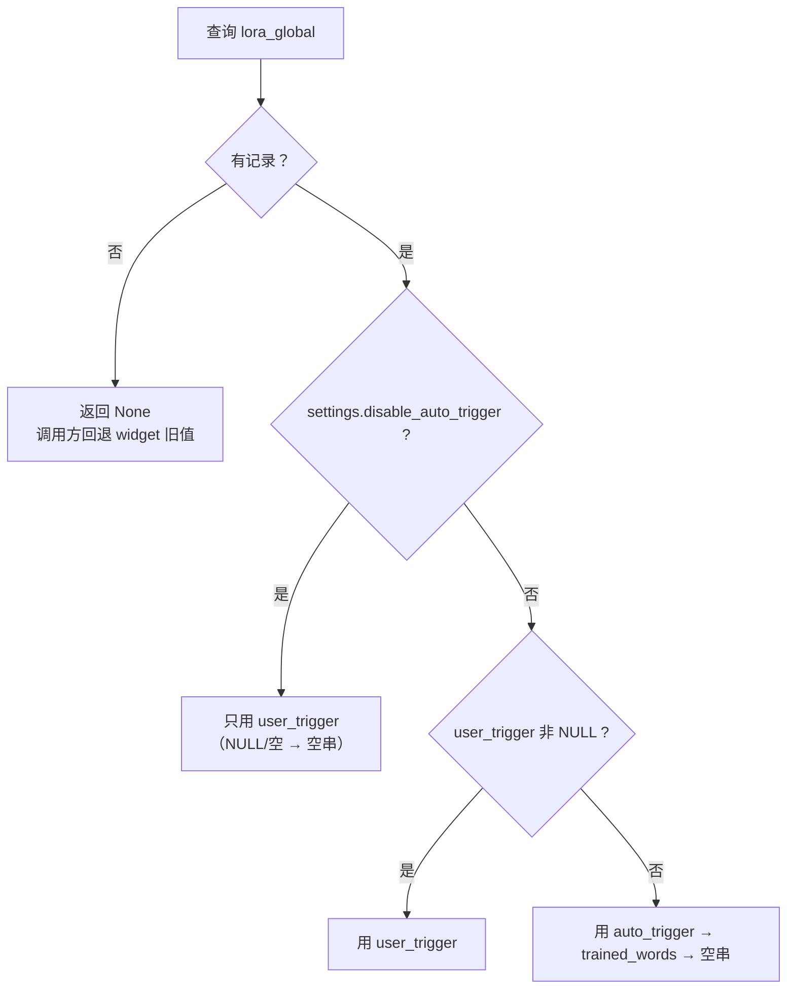
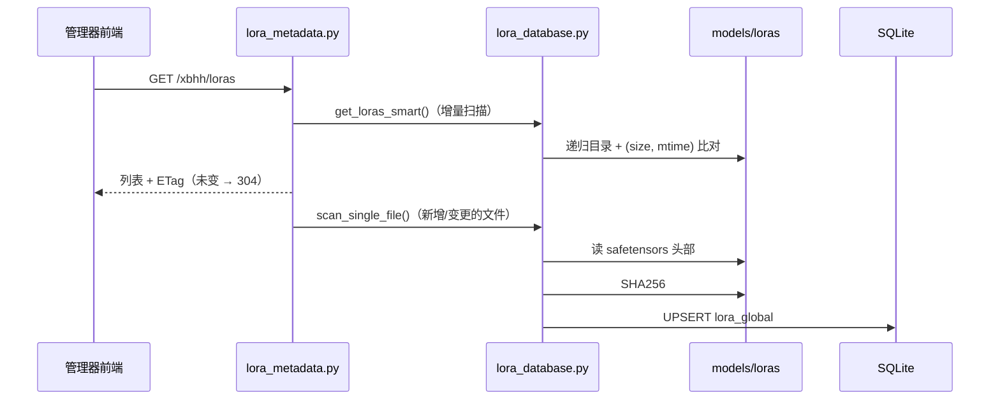
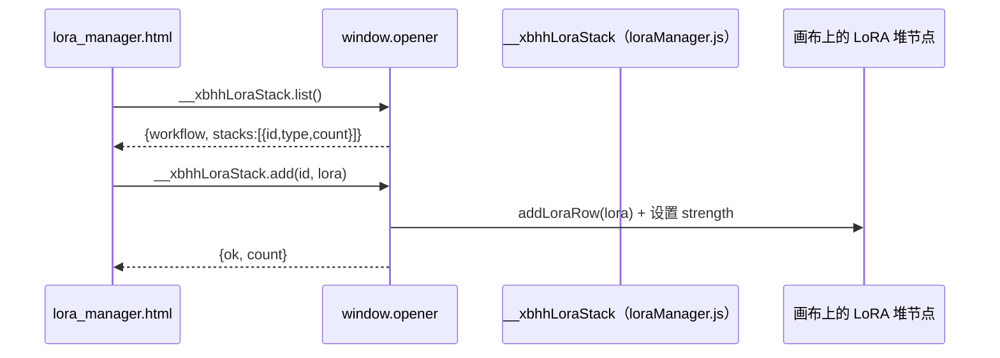
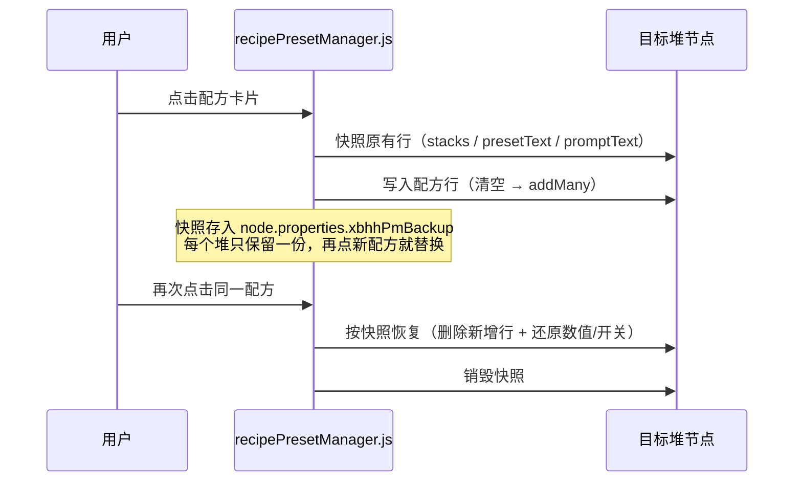
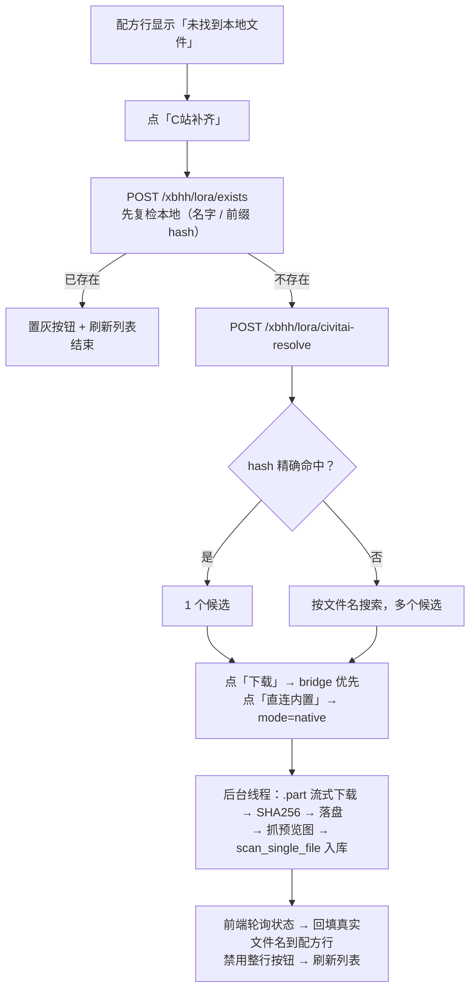

# XBHH ComfyUI 套件 · 架构与 LoRA 数据结构说明

> 适用版本：`2.0.1`（见 [pyproject.toml](./pyproject.toml)）
> 本文档面向维护者，说明代码分层、节点清单、**LoRA 的数据结构（磁盘 / 数据库 / 节点 / 预设文本 / 配方 / 接口）** 与关键数据流。

---

## 1. 项目概览

本插件是一个 ComfyUI 自定义节点包，能力分三块：

| 能力域 | 说明 | 主要文件 |
| --- | --- | --- |
| LoRA 管理 | 独立管理器页面（列表 / 触发词 / 分类 / 评级 / 参考图 / 配方 / 备份体检）+ 画布上的多 LoRA 堆节点 | `lora_database.py`、`lora_metadata.py`、`lora_loader.py`、`lora_loader_plus.py`、`web/lora_manager.html` |
| 工作流效率节点 | 空 Latent、动态文本、注释/分层注释、txt 选择器、xlsx 查看器、提示词格式化等 | `empty_latent.py` 等 |
| Live2D 看板娘 | 在 ComfyUI 界面中挂载 Live2D V2/V4 模型，支持交互、换装、热键 | `pet/`、`web/js/pet/`、`web/live2d/` |

运行形态：**Python 节点 + aiohttp 路由 + 前端 ES Module 扩展 + 独立 HTML 管理器页**。
`__init__.py` 里 `WEB_DIRECTORY = "./web"`，ComfyUI 会把 `web/` 下的 JS 全部注入前端。

---

## 2. 分层架构



要点：

- **管理器是独立标签页**（`window.open('/xbhh/lora-manager')`），拿不到画布的 `app`，所以通过 `window.opener.__xbhhLoraStack` 跨窗口调用桥接。
- 所有耗时文件操作（递归扫描、哈希、下载）都走 `asyncio.to_thread` 或后台线程，避免阻塞 ComfyUI 事件循环。

---

## 3. 目录与文件职责

```
Comfyui-xbhh-main/
├─ __init__.py              # 节点注册入口 + WEB_DIRECTORY
├─ lora_loader.py           # 基础 LoRA 堆后端 + 列表/预览图/缩略图路由
├─ lora_loader_plus.py      # 堆 Plus 后端（预设文本解析/生成、触发词拼装、返回 MODEL/CLIP/文本）
├─ lora_database.py         # SQLite 读写、扫描入库、LFU、Civitai 下载器、备份清单
├─ lora_metadata.py         # 管理器全部 HTTP 路由（元数据/触发词/分类/参考图/配方图/C站/备份）
├─ recipe_preset_manager.py # 「预设管理（配方）」节点的后端空壳（仅透传两个 STRING）
├─ preset_selector.py       # JSON 预设选择器节点
├─ prompt_formatter.py      # 提示词格式化节点
├─ dynamic_text.py          # 动态文本（%date% / %counter% / %random%）
├─ empty_latent.py          # 空 Latent（常用分辨率预设）
├─ note_node.py             # 注释节点
├─ layered_note.py          # 分层注释节点
├─ txt_randomizer.py        # txt 随机抽取
├─ xbhh_txt_selector.py     # txt 选择器
├─ xlsx_viewer.py           # xlsx 查看器
├─ image_title.py           # 图片标题
├─ lora_test_loader.py      # 测试堆（已在 __init__.py 中注释下线）
├─ pet/                     # Live2D 看板娘后端（钱包、保存图片、模型扫描）
├─ utils/                   # 工具页（lora_viewer.html、表情补全脚本）
├─ web/
│  ├─ lora_manager.html     # ★ 管理器主界面（单文件，含 CSS/JS）
│  ├─ assets/               # 鲸鱼钱包素材
│  ├─ js/                   # 各节点的前端扩展
│  ├─ lib/live2d/           # Live2D 运行时库
│  └─ live2d/               # Live2D 模型（v2 / v4）
└─ data/                    # 示例图片、工作流说明、logo
```

---

## 4. 节点清单

| 注册名 | 显示名 | 文件 | 作用 |
| --- | --- | --- | --- |
| `XBHHMultiLoraLoader` | XBHH Multi Lora Loader | `lora_loader.py` | 基础多 LoRA 堆，点击追加槽位 |
| `XBHHMultiLoraLoaderPlus` | XBHH Multi Lora Loader Plus | `lora_loader_plus.py` | 堆 + 预设导入导出 + 预设文本输出 |
| `XBHHRecipePresetManager` | XBHH 预设管理（配方） | `recipe_preset_manager.py` | 节点内嵌面板，无线把配方写进画布上的堆 |
| `PresetSelector` | xbhh JSON预设选择器 | `preset_selector.py` | 从 JSON 预设取值 |
| `PromptRandomizer` | xbhh txt随机抽取 | `txt_randomizer.py` | 文本库随机取词 |
| `XBHHTxtSelector` | xbhh txt选择器 | `xbhh_txt_selector.py` | 文本库选择 |
| `XBHHPromptFormatter` | XBHH Prompt Formatter | `prompt_formatter.py` | 组合带触发词的提示词 |
| `XBHHDynamicText` | xbhh 动态文本 | `dynamic_text.py` | 变量替换（日期/计数/随机） |
| `XBHHEmptyLatent` | xbhh 空Latent | `empty_latent.py` | 分辨率预设 + 8 倍数对齐 |
| `XBHHNoteNode` | xbhh 注释节点 | `note_node.py` | 画布笔记 |
| `XBHHLayeredNote` | xbhh 分层注释 | `layered_note.py` | 带层级的注释 |
| `XBHHXlsxViewer` | xbhh XLSX查看器 | `xlsx_viewer.py` | 免 Excel 预览 xlsx |
| `XBHHImageTitle` | XBHH Image Title（图片标题） | `image_title.py` | 图片标题生成 |
| `XBHHSaveImageWithCUI` | xbhh 保存图片 (CUI奖励) | `pet/save_image_cui.py` | 保存图片并结算看板娘货币 |
| `XBHHLoraTestLoader` | XBHH Lora Test Loader | `lora_test_loader.py` | **已下线**（`__init__.py` 中注释） |

---

## 5. LoRA 数据结构（核心）

同一个 LoRA 在系统里有 **5 种表示**，理解它们的对应关系是读懂整套代码的前提：



一句话对应关系：

| 表示 | 用途 | 谁是权威 |
| --- | --- | --- |
| 磁盘文件 | 真正参与推理的权重 | 磁盘 |
| `lora_global` | 触发词 / 分类 / 评级 / LFU / 备份 | **DB** |
| 节点 widget | 单次运行要用哪些行、什么强度 | 工作流 |
| `preset_text` | 在节点之间搬运配置 | 节点（导出时生成） |
| `recipe` | 跨工作流的可复用组合 | `settings.json` |

关键约定：**节点里的 `trigger` 只是快照，执行时一律回 DB 取触发词**（见 5.3 优先级图）。

### 5.1 物理层：一个 LoRA 在磁盘上的组成



预览图查找顺序（`lora_loader.py::_get_lora_images_sync`）：
`png → jpg → jpeg → webp → preview.png → preview.jpeg → preview.webp`，取第一个命中的。

其他固定目录：

| 目录 | 内容 |
| --- | --- |
| `<第一个 LoRA 根目录>/xbhh_recipe_previews/` | 配方预览图（旧版在 `output/xbhh_recipe_previews`，启动后会自动迁移路径） |
| `ComfyUI/user/xbhh/thumbs/` | 列表/悬浮预览的缩略图缓存（放 temp 会被 ComfyUI 定期清掉） |

### 5.2 身份标识：两套 hash 体系（很多 bug 的根源）

| 体系 | 长度 | 产生方 | 用途 |
| --- | --- | --- | --- |
| **SHA256** | 64 位十六进制 | 本地对文件内容做哈希（`calculate_file_sha256`） | `lora_global.hash` 主键；备份体检、去重 |
| **AutoV2** | 10~12 位 | Civitai 返回（SHA256 的前缀） | C 站搜索 / 补全 / 下载 |

匹配规则（前后端一致）：

- 长度 = 64 → 精确比较；
- 长度 < 64 → **前缀匹配**（`LIKE 'xxx%'` / `startsWith`）。



### 5.3 数据库记录：`lora_global`

SQLite 文件：`ComfyUI/user/xbhh/lora_trigger_word.db`（首次运行会从旧的 `插件目录/data/` 自动迁移）。

```sql
CREATE TABLE lora_global (
    hash TEXT PRIMARY KEY,      -- 64 位 SHA256
    name TEXT,                  -- 相对名（Windows 用反斜杠，如 画风\xxx.safetensors）
    file_path TEXT,             -- 绝对路径
    file_size INTEGER,
    file_mtime REAL,
    user_trigger TEXT,          -- 用户自定义触发词（NULL = 未自定义）
    auto_trigger TEXT,          -- 自动提取的触发词
    trained_words TEXT,         -- safetensors 元数据里的 ss_tag_frequency 提取词
    metadata TEXT,              -- safetensors __metadata__ 原文（JSON 字符串）
    use_count INTEGER DEFAULT 0,-- LFU 使用次数
    last_used TIMESTAMP,
    profiles TEXT,              -- 多套提示词 Profile（JSON）
    category TEXT,              -- 分类（画风/人物/场景…）
    base_model_override TEXT,   -- 手动覆盖底模名，优先于文件元数据
    rating INTEGER DEFAULT 0    -- 0~5 星
);
-- 索引：idx_lora_name(name)、idx_lora_use(use_count)
```

另有 LFU 缓存表（内存侧的落盘版本，供执行时快速取触发词）：

```sql
CREATE TABLE lora_cache (
    hash TEXT PRIMARY KEY,
    name TEXT,
    user_trigger TEXT,
    auto_trigger TEXT,
    trained_words TEXT,
    use_count INTEGER
);
```

**触发词优先级**（`get_active_trigger_from_db` + `/xbhh/lora/trigger` 同语义）：



### 5.4 节点内部：一行 LoRA 的 widget 值

画布节点里每个 LoRA 槽位是一个隐藏 widget（`lora_N`），`value` 是一个对象：

```json
{
  "on": true,
  "lora": "画风\\korean_doll_likeness.safetensors",
  "strength": 0.8,
  "strengthTwo": 0.8,
  "trigger": "",
  "triggerWeight": 1.0
}
```

| 字段 | 含义 | 备注 |
| --- | --- | --- |
| `on` | 是否启用 | 关闭的行不参与加载 |
| `lora` | 相对名 | 必须与 `folder_paths.get_filename_list("loras")` 一致（Windows 反斜杠） |
| `strength` | MODEL 强度 | 写入预设文本第 3 段 |
| `strengthTwo` | CLIP 强度 | 空/0 时回退 `strength` |
| `trigger` | 触发词缓存快照 | **不参与执行**，执行时以数据库为准 |
| `triggerWeight` | 触发词权重 | 1.0 时自动跟随 `strength` |

例外：由 `lora_preset` 连线灌进来的行，key 是 `PRESET_<lora名>`，结构相同。

### 5.5 预设文本（`preset_text`）行格式

```
启用|LoRA相对名|MODEL强度|CLIP强度||触发词权重
 1  |画风\x.safetensors|0.8|0.8||1.0
```

- 第 1 段：`1` / `0`（启用/禁用）
- 第 2 段：LoRA 相对名
- 第 3、4 段：MODEL / CLIP 强度
- 第 5 段：**恒为空**（历史字段，触发词不再随预设流转）
- 第 6 段：触发词权重

解析与生成都在 [lora_loader_plus.py](./lora_loader_plus.py)：`load_loras()` 先处理 `lora_preset` 连线（同名 LoRA 以手动行优先），再统一遍历 `lora_N` / `PRESET_*`。

### 5.6 配方（recipe）结构

配方不是独立的数据库表，而是存在 `settings.json` 的 `recipes` 数组里，由管理器通过 `POST /xbhh/lora/settings` 整体保存（250ms 防抖 + 失败重试，原子写盘）。

```json
{
  "id": "r_1720000000000",
  "name": "韩系人像",
  "category": "人物",
  "prompt": "masterpiece, 1girl, ...",
  "preview": "loras/xbhh_recipe_previews/韩系人像_r_1720.png",
  "tags": ["人像", "韩系"],
  "note": "",
  "rating": 5,
  "updated": 1720000000000,
  "loras": [
    {
      "on": true,
      "name": "画风\\korean_doll_likeness.safetensors",
      "hash": "a1b2c3d4e5",
      "weight": 0.8,
      "weightClip": 0.8,
      "triggerWeight": 1.0
    }
  ]
}
```

| 字段 | 说明 |
| --- | --- |
| `name` / `hash` | hash 可为空（保存前回填）或 AutoV2 |
| `weight` / `weightClip` | 对应节点的 `strength` / `strengthTwo` |
| `triggerWeight` | 对应节点的 `triggerWeight` |
| `preview` | 相对 ComfyUI 根目录的路径 |
| `on` | 缺省视为 `true` |

---

## 6. 关键数据流

### 6.1 扫描入库



### 6.2 从管理器把 LoRA 加到画布



桥接 API：`list / add / addMany / create / preset`。

### 6.3 配方应用与取消（点一次应用、再点取消）



恢复只写 widget 值、不触发回调，避免"恢复"又被当成一次应用。

### 6.4 C 站补齐（缺失 LoRA 下载）



后端两道查重：前端提交前 `/xbhh/lora/exists`；worker 落盘前按 basename 全目录查一遍（命中直接返回「本地已有同名文件，跳过下载」）。

### 6.5 备份与体检

- `POST /xbhh/lora/backup/export`：把整库指纹（name / hash / size）+ 用户数据写成 manifest JSON。
- `POST /xbhh/lora/backup/inspect`：拿 manifest 与当前库按 hash 比对，列出缺失。
- 默认落点 `ComfyUI/user/xbhh/backup`，可用 `settings.backup_dir` 覆盖。

---

## 7. HTTP API 一览

管理器的路由集中在 [lora_metadata.py](./lora_metadata.py)，列表/缩略图在 [lora_loader.py](./lora_loader.py)。

### 7.1 列表与预览

| 方法 | 路径 | 说明 |
| --- | --- | --- |
| GET | `/xbhh/loras` | LoRA 列表（增量扫描 + ETag/304） |
| GET | `/xbhh/images/loras` | 名字 → 预览图路径映射 |
| GET | `/xbhh/view/{name}` | 预览图，`?thumb=<宽>` 走磁盘缩略图缓存 |
| GET | `/xbhh/lora-manager` | 管理器页面 |
| GET | `/xbhh/lora-manager-demo` | 演示页面 |

### 7.2 元数据与用户数据

| 方法 | 路径 | 说明 |
| --- | --- | --- |
| GET | `/xbhh/lora/metadata/{name}` | 单个 LoRA 元数据 |
| GET | `/xbhh/lora/metadata-batch` | 批量元数据 |
| GET | `/xbhh/lora/folders` | 目录树 |
| GET / POST | `/xbhh/lora/settings` | 全站设置（含 recipes、disable_auto_trigger、backup_dir） |
| GET | `/xbhh/lora/categories` | 分类列表 |
| GET / POST | `/xbhh/lora/trigger`、`/trigger/update`、`/trigger/batch-update` | 触发词读写 |
| POST | `/xbhh/lora/recalculate-auto-triggers` | 重算自动触发词 |
| GET / POST | `/xbhh/lora/profiles`、`/profiles/update` | 多套提示词 Profile |
| POST | `/xbhh/lora/category/update`、`/rating/update` | 分类 / 评级 |
| POST | `/xbhh/lora/use` | LFU 计数 |

### 7.3 参考图与配方图

| 方法 | 路径 | 说明 |
| --- | --- | --- |
| GET | `/xbhh/lora/ref-images`、`/ref-subdirs`、`/ref-image` | 参考图列表 / 子目录 / 单图 |
| POST | `/xbhh/lora/ref-image/upload`、`/rename`、`/move`、`/delete` | 参考图管理 |
| GET / POST | `/xbhh/lora/ref-image/trash`、`/trash/restore` | 回收站 |
| POST | `/xbhh/lora/send-to-input` | 参考图送到 input 目录 |
| GET | `/xbhh/lora/recipe-preview-dir` | 配方图目录（含旧目录，供迁移） |
| POST | `/xbhh/lora/recipe-preview/upload`、`/rename`、`/delete` | 配方图管理 |
| POST | `/xbhh/lora/upload-image`、`/delete-image` | 通用图片上传/删除 |
| POST | `/xbhh/lora/pick-directory` | 原生目录选择 |
| POST | `/xbhh/lora/reveal` | 资源管理器定位文件 |

### 7.4 C 站与文件操作

| 方法 | 路径 | 说明 |
| --- | --- | --- |
| POST | `/xbhh/lora/exists` | 下载前复检本地是否已有（名字 / 前缀 hash） |
| POST | `/xbhh/lora/civitai-resolve` | 按 hash / 文件名找候选 |
| POST | `/xbhh/lora/civitai-download` | 提交下载（`mode:"native"` 绕过桥接工具） |
| GET | `/xbhh/lora/civitai-download/status` | 下载进度 |
| POST | `/xbhh/lora/civitai-link` | 生成 C 站链接 |
| GET | `/xbhh/lora/check-duplicates` | 重复文件检测 |
| POST | `/xbhh/lora/rename` | 重命名（同步预览图与 DB） |
| POST | `/xbhh/lora/delete-files` | 删除文件 |
| POST | `/xbhh/lora/update-base-model` | 覆盖底模名 |

### 7.5 备份

`/xbhh/lora/backup/export`、`/backup/list`、`/backup/inspect`、`/backup/restore`、`/backup/restore/status`、`/backup/restore/cancel`。

---

## 8. 前端文件清单

| 文件 | 扩展名 | 职责 |
| --- | --- | --- |
| `web/lora_manager.html` | — | 管理器官网页面，三种模式：`data-mode="lora" / "recipe" / "ref"` |
| `web/js/loraManager.js` | `xbhh.LoraManager` | 画布桥接 `window.__xbhhLoraStack`、列表侧边栏入口 |
| `web/js/loraCombo.js` | `xbhh.MultiLoraLoader` | 基础堆 UI（动态加行、树形选 LoRA、悬浮预览） |
| `web/js/loraComboPlus.js` | `xbhh.MultiLoraLoaderPlus` | Plus 堆 UI（预设导入导出、触发词弹窗） |
| `web/js/recipePresetManager.js` | `xbhh.RecipePresetManager` | 配方节点 DOM 面板 + 应用/撤销快照 |
| `web/js/dropLoader.js` | `xbhh.dropLoader` | 拖图进画布创建节点（含 PNG 元数据解析） |
| `web/js/toastTamer.js` | `xbhh.ToastTamer` | 提示消息收敛 |
| `web/js/xbhhUserSettings.js` | `xbhh.UserSettings` | 侧边栏设置面板 |
| `web/js/pet/live2d_pet.js` 等 | — | 看板娘加载、交互、热键、货币 |
| 其余 `emptyLatent / dynamicText / noteNode / layeredNote / whale_widget` | — | 对应节点的前端增强 |

---

## 9. 持久化数据位置一览

| 数据 | 位置 | 写入方式 |
| --- | --- | --- |
| LoRA 数据库 | `ComfyUI/user/xbhh/lora_trigger_word.db` | SQLite（`_db_lock` 串行化） |
| 全站设置 / 配方 / 目录配置 | `ComfyUI/user/xbhh/settings.json` | 临时文件 + `os.replace` 原子替换 |
| 缩略图缓存 | `ComfyUI/user/xbhh/thumbs/` | 按需生成 |
| 备份清单 | `ComfyUI/user/xbhh/backup/`（可配置） | 原子写 manifest |
| 配方预览图 | `<LoRA 根目录>/xbhh_recipe_previews/` | 上传后落盘 |
| 节点内的画布状态 | 工作流 JSON（`node.widgets` / `node.properties`） | 随工作流保存 |

---

## 10. 已知限制与待办

| 类型 | 内容 |
| --- | --- |
| 待做 | **拖图导入配方**：从 PNG 的 `workflow` 元数据识别 LoRA 堆并生成配方（`parsePngTextChunks` 目前是 `dropLoader.js` 私有函数，需先导出） |
| 待做 | 内容级去重：现在只按文件名查重，文件名不同但内容相同的仍会多下一份（可复用 `_find_other_same_content`） |
| 性能 | `/xbhh/lora/exists` 每次全树扫描（一次下载调两次），大库有开销；**不建议加缓存**，否则会误判刚移回的文件 |
| 性能 | 悬浮大图可加 `?thumb=800`；详情接口可裁剪 `raw_metadata`；`ref-images` 可改 scandir + `to_thread`；`sync_lfu_cache` 可改单行更新；SQLite 可开 WAL；长列表可上虚拟滚动 |
| 已知坑 | hash 双体系（64 位 SHA256 vs 10~12 位 AutoV2）必须按长度分流，任何新加的匹配逻辑都要遵守前缀规则 |
| 已知坑 | Windows 下 LoRA 相对名用反斜杠，前端比较需统一归一化（`replace(/\\/g,"/").toLowerCase()`） |
| 已知坑 | 预览图放 `temp` 会被 ComfyUI 定期清理，必须放 `user/xbhh` |

---

_文档随代码演进，改动数据结构或新增路由时请同步更新第 5、6、7 节。_
