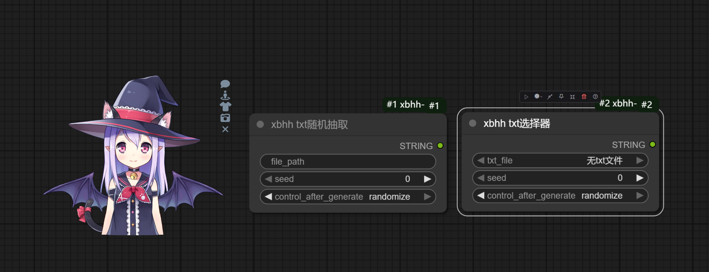
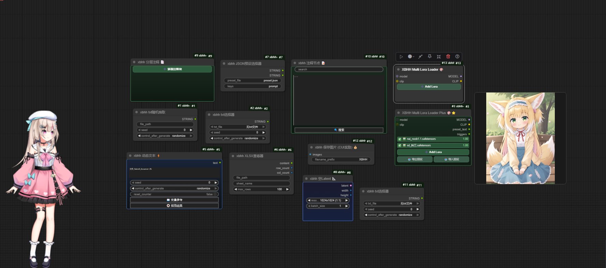

# XBHH ComfyUI Kit 🎨


English | [简体中文](./README.md)

**XBHH ComfyUI Kit** is a custom node pack for heavy LoRA users. It connects *model management → recipe composition → missing-model recovery → backup & audit* into one workflow, and ships a fully interactive Live2D mascot plus a set of productivity nodes.

- 🗂 **LoRA Manager** — a standalone page for browsing, triggers, categories, ratings, reference images, recipes, backup & audit
- 🧩 **LoRA Stack Plus** — unlimited rows on the canvas, with preset text import / export
- ⬇️ **Civitai Fill** — resolve missing LoRAs by hash or filename, with a built-in downloader that auto-imports
- 🎭 **Live2D Pet** — V2 / V4 / V5 models, outfits, expressions, motions, VTS hotkeys, coins & feeding

> For internals, see [ARCHITECTURE.md](./ARCHITECTURE.md) (Chinese) — layered design, **LoRA data-structure diagrams**, and data-flow sequences.

---

## ✨ Feature Overview

| Module | Capabilities |
| --- | --- |
| LoRA Manager | Tree view, sortable/filterable columns, thumbnails & hover preview, three-source trigger labels, batch trigger editing, categories, star ratings, usage counts |
| Recipes | Card-based recipe library, one-click apply / click-again-to-undo, recipe images, tags, share-file import & export |
| Reference images | Upload, rename, move, delete, recycle bin, send straight to a LoadImage node |
| Civitai Fill | Missing detection, local re-check, candidate list, built-in downloader, auto preview, auto import |
| Backup & Audit | Export a fingerprint manifest, diff it against the current library, redownload what is missing |
| Canvas nodes | LoRA Stack / Stack Plus, recipe node, preset selector, prompt formatter, dynamic text, etc. |
| Live2D | Multi-model switching, outfits, expressions & motions, custom hotkeys, click-through mode, coins & feeding |

---

## 🗂 LoRA Manager

Open it from the sidebar **LoRA Data** button (or the global hotkey). The page has three modes: **LoRA / Recipes / Reference**.

### LoRA list

- **Tree view** mirrors the real `models/loras` folder structure
- **Resizable columns** for long names and long trigger words
- **Sorting & filtering** by name, category, rating, usage count, modified time
- **Previews** — list thumbnail plus hover zoom, with automatic fallback
- **Trigger sources** — `[custom]` / `[auto]` / `[civitai]`, with one-click clear, batch update and recalculation
- **Multiple profiles** per LoRA — keep several prompt styles and switch between them
- **File operations** — rename (preview and DB stay in sync), delete, reveal in Explorer, duplicate detection
- **Performance** — incremental scan + ETag, unchanged folders return `304`

### Trigger resolution order

The database is authoritative at execution time; the value stored in the node is only a snapshot:

```
user_trigger  >  auto_trigger  >  trained_words (from safetensors)
```

When "disable auto trigger" is on, only your custom value is used.

---

## 📦 Recipes

Save a set of LoRAs, weights and prompt text as a reusable recipe card.

- **Apply once, click again to undo** — before applying, the target stack's rows, preset text and prompt text are snapshotted into node properties; clicking the same recipe again restores that snapshot exactly
- **Stacks are isolated** — every LoRA stack keeps its own snapshot; applying a new recipe only replaces that stack's snapshot
- **Recipe images** — upload a preview; the library is laid out as cards
- **Metadata** — name, category, tags, rating, notes
- **Sharing** — export a recipe as a share file; missing LoRAs are listed after import and can be filled from Civitai directly
- **Name fallback** — old filenames or short AutoV2 hashes are still matched by prefix

---

## ⬇️ Civitai Fill

1. The row's **Civitai Fill** button first **re-checks locally** via `/xbhh/lora/exists` — if you just moved the file back, it is detected and the button is disabled
2. Otherwise the plugin resolves candidates by hash (10–12 char AutoV2 prefixes supported) or filename
3. Choose a candidate:
   - **Download** — uses the local bridge tool when available
   - **Built-in** — no external software, uses the bundled downloader
4. The built-in downloader streams to a `.part` file → verifies SHA256 → moves into `models/loras` → fetches a preview → writes to the database
5. The recipe row is backfilled with the real filename, the whole row is disabled and the list refreshes

Before writing to disk, a **whole-tree basename check** prevents downloading a duplicate that already exists in a subfolder.

---

## 🛡 Backup & Audit

- **Export manifest** — fingerprints (filename / hash / size) plus user data such as category, triggers and rating
- **Audit** — diff the manifest against the current library and list missing files
- **Redownload** — missing entries can be sent to Civitai Fill in one go

Default location: `ComfyUI/user/xbhh/backup` (configurable).

---

## 🎭 Live2D Pet

- **Engines** — Live2D V2 (SDK 2.1) and V4 / V5 (Cubism 4/5)
- **Auto discovery** — every model under `web/live2d` is detected; switch from the right-click menu
- **Interaction** — mouse tracking, click dialogue, random idle motions, expression switching
- **Outfits** — one-click texture switching for V2 models
- **Hotkeys** — `.vtube.json` next to the model is parsed and its VTS hotkeys become keyboard shortcuts (toggleable); motions can be bound to custom keys
- **Click-through** — never blocks the canvas; right-click to open the menu
- **Coins** — chatting, feeding and the *Save Image (CUI Reward)* node all earn currency

> Adding your own model: see [LIVE2D_GUIDE.md](./LIVE2D_GUIDE.md) (Chinese).



---

## 🧩 Nodes

| Node | Purpose |
| --- | --- |
| **XBHH Multi Lora Loader** | Dynamic multi-row LoRA stack, tree picker, hover preview |
| **XBHH Multi Lora Loader Plus** | Everything above + preset text import/export + automatic trigger assembly |
| **XBHH Recipe Manager** | In-node recipe panel; writes recipes into stacks without wiring |
| **XBHH Prompt Formatter** | Concatenates LoRA triggers and prompt text in order |
| **JSON Preset Selector** | Pick a value from a JSON preset file |
| **TXT Random / Selector** | Random or manual pick from a text library |
| **Dynamic Text** | `%date%` / `%counter%` / `%random%` placeholders |
| **Empty Latent** | 15+ common resolutions, auto-aligned to multiples of 8 |
| **Note / Layered Note** | Canvas notes with layers and search highlighting |
| **XLSX Viewer** | Preview `.xlsx` without Excel |
| **Image Title** | Generate image titles |
| **Save Image (CUI Reward)** | Save an image and credit the mascot's wallet |



---

## 📦 Installation

### ComfyUI Manager (recommended)

Search for `xbhh` or `comfyui-xbhh-lora`, install, then restart ComfyUI.

### Manual

```bash
cd ComfyUI/custom_nodes
git clone https://github.com/xbhh123456/Comfyui-xbhh-main.git
cd Comfyui-xbhh-main
pip install -r requirements.txt
```

The only dependency is `openpyxl` (for the XLSX viewer). After restarting, press `Ctrl + F5` once to clear the front-end cache.

### Created on first launch

| Path | Contents |
| --- | --- |
| `ComfyUI/user/xbhh/lora_trigger_word.db` | LoRA database (triggers / categories / ratings / usage) |
| `ComfyUI/user/xbhh/settings.json` | Global settings and recipes |
| `ComfyUI/user/xbhh/thumbs/` | Thumbnail cache |
| `ComfyUI/user/xbhh/backup/` | Backup manifests |

Everything lives under `user/`, so **upgrading the plugin never loses your data**.

---

## 🚀 Quick Start

1. **Build the library** — drop LoRAs into `ComfyUI/models/loras/` (subfolders are fine); the first scan computes hashes
2. **Organize** — add custom triggers, categories and ratings to your favourites
3. **Make a recipe** — create one, pick LoRAs, tune weights, attach an image and prompt text
4. **Use it** — add a LoRA stack (or the recipe node) to your workflow and click the recipe; click again to undo
5. **Move machines** — export a backup manifest, audit on the new machine and fill the gaps from Civitai

---

## 🆕 v2.0.1

**Added**

- **Recipe manager** — card library, recipe images, tags, rating, notes, apply / undo
- **Civitai Fill** — built-in downloader: stream → SHA256 → preview → auto import
- **Backup & Audit** — export manifest, diff, bulk redownload
- **Reference library** — upload, rename, move, delete, recycle bin, send to LoadImage
- **LoRA metadata** — multiple prompt profiles, categories, ratings, usage stats
- **Live2D** — automatic `.vtube.json` hotkeys and custom motion shortcuts

**Fixed**

- Recipes failing to locate local files by hash: **AutoV2 prefix matching** (front-end and back-end)
- `/xbhh/lora/exists` dispatches by hash length (exact for 64 chars, prefix otherwise)
- **Local re-check before download** so a just-restored file is not downloaded twice
- **Backfill the real filename** after download and disable the entire row
- **Stop polling** when a download task is lost (e.g. backend restart)
- **Whole-tree basename dedupe** before writing a downloaded file
- **Normalized case and path separators** when restoring recipe snapshots

**Docs**

- New [ARCHITECTURE.md](./ARCHITECTURE.md) (Chinese) with LoRA structure and data-flow diagrams
- Chinese README rewritten, English README added
- [LIVE2D_GUIDE.md](./LIVE2D_GUIDE.md) rewritten

---

## ⚠️ FAQ

**Front-end changes not visible?**
Browser cache is stubborn — always `Ctrl + F5`; restart the ComfyUI backend after Python changes.

**Recipe hash does not match the database?**
Civitai gives a 10–12 char AutoV2 (a SHA256 prefix), while the local DB stores the full 64-char SHA256. The plugin dispatches by length: exact for 64, prefix otherwise.

**Backslashes in LoRA names on Windows?**
That is ComfyUI's convention (`style\x.safetensors`); comparisons are normalized internally.

**Do thumbnails disappear?**
They live in `user/xbhh/thumbs`, not in `temp`, so ComfyUI's temp cleanup will not touch them.

**Does Civitai Fill require external software?**
No. The candidate row's **Built-in** option uses the bundled downloader; if a bridge tool is installed it is preferred.

---

## 📅 Roadmap

- [x] Live2D V2 / V4 / V5 engines
- [x] LoRA manager with trigger database
- [x] Recipes with apply / undo
- [x] Civitai Fill with built-in downloader
- [x] Backup manifest and audit
- [ ] Build recipes directly from image metadata
- [ ] Content-based (not filename-based) deduplication
- [ ] More Live2D interactions

---

## 📚 Documentation

- [README.md](./README.md) — Chinese README
- [ARCHITECTURE.md](./ARCHITECTURE.md) — architecture, node list, **LoRA five-layer data structure**, sequence diagrams, HTTP API
- [LIVE2D_GUIDE.md](./LIVE2D_GUIDE.md) — model layout, adding models, expressions, hotkeys, troubleshooting
- [CHANGELOG.md](./CHANGELOG.md) — release notes

---

## 📄 License

MIT.

## 🙏 Credits

- [ComfyUI](https://github.com/comfyanonymous/ComfyUI)
- [rgthree-comfy](https://github.com/rgthree/rgthree-comfy) for UI inspiration
- Live2D runtime and model authors

---

_If this kit helps you, a Star 🌟 is appreciated._
